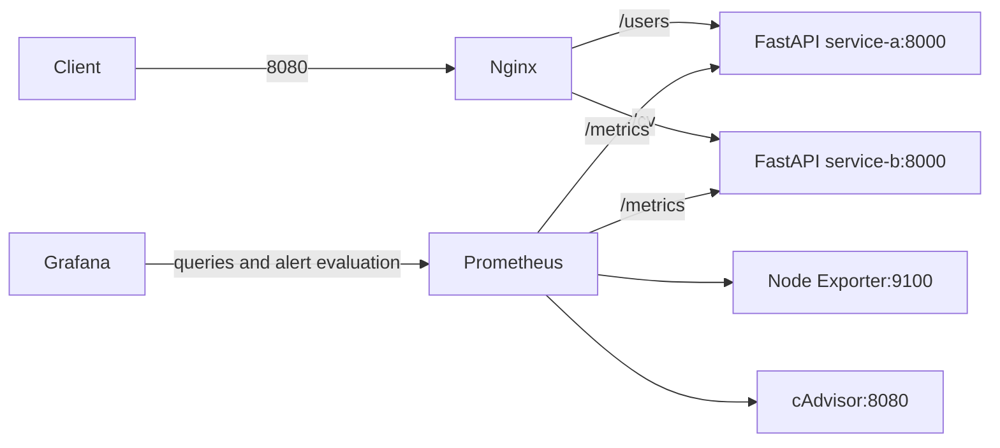

# Docker Monitoring and Observability

A reproducible local monitoring stack for two FastAPI services behind Nginx:
Prometheus, Grafana, Node Exporter, and cAdvisor. Dashboards and alert rules are
versioned and load automatically, including on a fresh Grafana installation.



The application is in the related
[reverse proxy repository](https://github.com/shakibaznejad-commits/docker-nginx-reverse-proxy).
Both Compose projects join the external `monitoring-network`. Prometheus uses
`service-a:8000` and `service-b:8000`, so discovery does not depend on the Compose
project directory name. Run only one pair of services with these aliases on the
shared network to avoid ambiguous DNS.

## Files

- `docker-compose.yml`: monitoring containers, existing ports and Grafana volume.
- `prometheus/prometheus.yml`: five scrape jobs, sampled every 15 seconds.
- `grafana/provisioning/`: datasource, dashboard provider and seven alert rules.
- `grafana/dashboards/`: infrastructure and application dashboard JSON.
- `.env.example`: safe optional SMTP configuration.
- `scripts/validate.py`: configuration, PromQL and contract checks.
- `scripts/verify_live.py`: isolated integration test and alert failure/recovery.

## Setup

Requirements: Docker Engine/Desktop with Compose, Git, and Linux-compatible host
mounts. For validation scripts, Python 3 and PyYAML (`python3 -m pip install
-r tests/requirements.txt`, preferably inside a virtual environment). The host must provide
`/dev/kmsg`, `/sys`, `/var/lib/docker` and `/dev/disk` for this cAdvisor setup.
cAdvisor runs in the host PID namespace and connects to
`/proc/1/root/run/containerd/containerd.sock`. This reaches Docker Desktop's
runtime even when WSL bind mounts point at the user's distro. If Docker uses a
legacy socket location, set `CADVISOR_CONTAINERD_SOCKET` locally (for example
`/proc/1/root/run/docker/containerd/containerd.sock`). Docker Desktop/WSL metrics describe the Docker Linux environment, which may differ
from the physical Windows/macOS host. Rootless Docker and restricted hosts may
need different exporter mounts/permissions.

```bash
git clone https://github.com/shakibaznejad-commits/docker-nginx-reverse-proxy.git reverse-proxy-project
git clone https://github.com/shakibaznejad-commits/docker-monitoring-project.git monitoring-project
docker network inspect monitoring-network >/dev/null 2>&1 || docker network create monitoring-network
cd reverse-proxy-project
docker compose config --quiet
docker compose up -d --build
cd ../monitoring-project
```

For a fresh checkout, copy `.env.example` to `.env` and edit locally. **Do not
overwrite an existing `.env`.** SMTP is optional; the example disables it.
Existing installations retain the previous SMTP-enabled default when the new
variable is absent. To send email, set `GRAFANA_SMTP_ENABLED=true`, configure the
SMTP host, username and password locally, then restart Grafana with
`docker compose up -d grafana`. No credentials belong in Git or dashboard JSON.

```bash
# Only for a fresh checkout without an existing .env:
cp .env.example .env
# Validate without printing interpolated credentials:
docker compose config --quiet
docker compose up -d
```

| Tool | URL |
| --- | --- |
| Grafana | http://localhost:3000 |
| Prometheus | http://localhost:9090 |
| Node Exporter | http://localhost:9100/metrics |
| cAdvisor (loopback only) | http://localhost:8082 |
| Application | http://localhost:8080/users and http://localhost:8080/cv |

Fresh Grafana uses its upstream initial admin login; change its password at first
login. Existing Grafana users, dashboards, alert contacts and passwords remain in
the existing `grafana-data` volume. Ports 3000, 9090 and 9100 preserve the original
all-interface bindings; restrict access with a firewall or loopback bindings
before exposing this demonstration host. cAdvisor retains privileged host access
for container metrics. This is a local demonstration, not a public authenticated
monitoring service.

## Dashboards and metrics

Open **Dashboards → Docker Monitoring**:

| Dashboard | Panels |
| --- | --- |
| Docker Infrastructure | Host CPU %, available-memory based RAM %, filesystem space used %, container CPU cores, container working set RAM, recently seen containers, exporter scrape availability |
| Docker Application | Endpoint request rate, HTTP 4xx/5xx rate, endpoint P95 processing time, 5xx percentage, application scrape availability, response rate by status |

The provisioned datasource is **Monitoring Prometheus**, UID
`monitoring-prometheus`, using `http://prometheus:9090`. It deliberately does not
replace an existing default datasource. Dashboard JSON explicitly references its
UID. Provisioned dashboards are controlled by Git; edit the JSON and wait about
30 seconds or restart Grafana. Alert and datasource provisioning reload on
Grafana startup. Existing UI dashboards and notification routing are retained.

Application metrics match the related project's implementation:

- `requests_total`: counts only the successful `/users` or `/cv` endpoint handler.
- `http_responses_total{status_code="..."}`: middleware response counters excluding
  `/metrics`; a status series may not exist before the first matching response.
- `http_request_duration_seconds_bucket`: time measured *inside the endpoint
  function*. It excludes proxy/network time, middleware overhead and failed
  requests. P95 is a histogram estimate, not end-to-end latency.
- `up`: Prometheus scrape success, not an HTTP business health check.

Useful PromQL:

```promql
up{job=~"service-a|service-b"}
sum by (job) (rate(requests_total{job=~"service-a|service-b"}[5m]))
sum by (job, status_code) (rate(http_responses_total{job=~"service-a|service-b",status_code=~"4..|5.."}[5m]))
histogram_quantile(0.95, sum by (job, le) (rate(http_request_duration_seconds_bucket{job=~"service-a|service-b"}[5m])))
```

Rates need at least two scrapes. Send traffic and allow a few minutes for useful
five-minute windows. No traffic means latency can be NaN; error panels can show
no data until an error status is observed. The 5xx percentage falls back to zero
when response traffic exists but there is no 5xx series.

## Alerts

Open **Alerting → Alert rules → Docker Monitoring Alerts**. Grafana evaluates
once per minute; the condition must hold continuously for the pending period.

| Rule | Condition | Pending | Severity |
| --- | --- | --- | --- |
| Application metrics unavailable | Either FastAPI scrape down | 2m | critical |
| Infrastructure metrics unavailable | Node Exporter or cAdvisor scrape down | 2m | critical |
| Application HTTP 5xx errors | More than 2 server errors in a rolling 5m window, per service | 2m | critical |
| Application P95 latency | Endpoint P95 above 1 second | 5m | warning |
| Host CPU pressure | Non-idle CPU above 85% | 10m | warning |
| Host memory pressure | Used RAM above 90% | 5m | warning |
| Filesystem almost full | Space used above 90%, excluding pseudo filesystems | 5m | critical |

Rules include actionable annotations and `project=docker-monitoring` and
`severity` labels. Missing query data is explicitly `NoData` and query failures
are `Error`, so missing telemetry is not silently reported as healthy. Idle
applications can produce no-data latency alerts; tune this policy for your
traffic. Grafana must be running to evaluate rules; use an external monitor to
detect failure of the entire monitoring stack.

**Notification delivery is a separate operator step.** In Grafana, create or
verify a contact point and route `project=docker-monitoring` to it in notification
policies. Send a test notification. SMTP configuration enables transport but
does not create a recipient. Provisioning deliberately leaves existing contact
points and policies intact, so no recipient, webhook secret or SMTP password is
committed. Alerts are still visible in Grafana without SMTP.

To safely test application-down alerting, prefer `scripts/verify_live.py` below.
It stops only its own disposable test service and verifies firing and recovery.
Do not stop a real service unless a brief outage is acceptable. The existing demo
endpoints complete quickly and provide no deliberate 500 endpoint; HTTP error
and high-latency thresholds are tested with synthetic metrics, not by changing
the application to fail.

## Verification and tests

```bash
# Local contracts + both YAML/JSON provisioning and every PromQL expression:
python3 scripts/validate.py
# Related application Compose:
docker compose -f ../reverse-proxy-project/docker-compose.yml config --quiet
# Build the images needed by the isolated test if not already cached:
docker compose -f ../reverse-proxy-project/docker-compose.yml build
# Full isolated integration test (several minutes):
python3 scripts/verify_live.py
```

For a nonstandard runtime socket, export `CADVISOR_CONTAINERD_SOCKET` before
running the smoke test; it intentionally does not load local `.env` files.

The isolated test creates a uniquely named Docker network and containers, uses
RAM-backed Prometheus/Grafana storage, checks both provisioned dashboards and
seven alerts through Grafana's APIs, verifies all five scrape targets and actual
dashboard queries, checks both Nginx routes, sends
requests to both FastAPI services, then verifies application-down alert firing
and recovery. It removes only resources it created. It does not mount the
existing Grafana volume, read `.env`, or alter the related repository.
`validate.py` uses the cached/pulled Prometheus image's `promtool` to validate
config and all dashboard/alert expressions as temporary recording rules, then
checks synthetic healthy and firing scenarios for all seven thresholds.

Manual verification:

```bash
curl -fsS http://localhost:8080/users
curl -fsS http://localhost:8080/cv
curl -fsS http://localhost:9090/-/ready
curl -fsS http://localhost:3000/api/health
curl -fsS http://localhost:9090/api/v1/targets
```

In Prometheus **Status → Target health**, all five jobs should be UP. In Grafana,
check both dashboards, CPU/RAM/container series, alert states and a test contact
notification. Keep `docker compose config` output out of reports because it
interpolates local secrets; use `--quiet` for validation.

## Troubleshooting and data preservation

- **FastAPI target down:** confirm both projects use `monitoring-network`, inspect
  `docker network inspect monitoring-network`, and check service logs. Service DNS
  works independently of directory names; conflicting service aliases can route
  to the wrong project. Both applications listen on port 8000 internally.
- **Missing dashboards:** check `docker compose logs grafana`, provisioning bind
  mounts, and the Docker Monitoring folder. Existing UI dashboards are separate.
- **No metrics or rate data:** generate traffic, wait for two or more scrapes and
  inspect raw metrics. Avoid changing a cumulative counter to clear an old error;
  the rolling window will expire it.
- **Exporter down or empty container panels:** check host mount availability,
  `/dev/kmsg`, Docker storage path and cAdvisor logs. A healthy scrape with empty container
  panels can mean Docker factory registration failed; check the containerd socket
  path and `CADVISOR_CONTAINERD_SOCKET`, not just `up`. Host/VM and cgroup layouts
  differ. Container memory and CPU alerts need workload-specific limits; this
  project provides host pressure alerts and per-container dashboards instead.
- **Alerts not delivered:** verify rule state, contact point, policy label match,
  SMTP enable flag and provider credentials. Use a test notification and Grafana
  logs; never paste credentials into issues.
- **Docker permission denied:** run with an account authorized to access Docker.
- **Port occupied:** inspect `docker ps`; change host-side mappings consistently
  in local configuration. Internal service ports stay unchanged.

Never run `docker compose down -v`, `docker volume prune`, or delete the existing
Grafana volume to troubleshoot provisioning. Back it up before upgrades. Existing
Grafana data persists in `grafana-data`; Prometheus retains its original storage
configuration (no new named persistent volume is introduced). Container
recreation can discard Prometheus's writable-layer history. Provisioned files
reproduce dashboards and rules, but do not back up existing UI state or metrics.

Image tags retain the existing choices (`latest` for Prometheus/Node Exporter,
Grafana `12.1`, cAdvisor `0.55.1`) to preserve compatibility. For a controlled
production deployment, pin reviewed digests and test upgrades. SMTP delivery and
cross-platform host metrics require environment-specific verification.

No license has been specified; add an appropriate license before distributing
under specific reuse terms.
